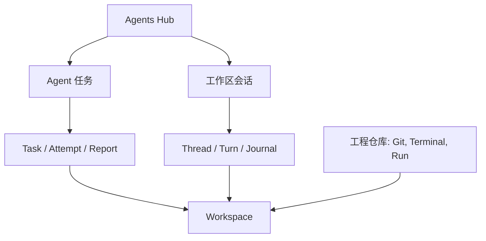

# Agents Hub consolidation audit — 2026-10-20

## Scope and baseline

Audited current main `3976ea6fcee52e8d00ebf5899998be6dbf4d4e49` (0.5.9),
including merged PR #89. The requested product boundary is one Agents Hub for
Agent work and repository tools for Git, Terminal and Run.

**结论：可以合并入口，而且有必要。** 原来的两处界面都能输入目标、启动 Agent、
观察进度和处理恢复，职责在交互层重叠。新的 Agents Hub 统一承接这些操作，
其中“Agent 任务”管理独立工作区中的受管任务，“工作区会话”保留已有工作区的
直接对话与 Provider 配置。工程仓库专注 Git、Terminal、Run 等开发工具。
任务和会话仍使用各自真实的记录与生命周期，已有线程不会被伪装成任务或验证结果。

## Findings and implemented direction

| Finding | Impact | Resolution |
| --- | --- | --- |
| Two places accept goals, start agents, show progress and recover work | Users must decide between overlapping entry points | Global Agents Hub with default Agent 任务 and existing-workspace sessions |
| Direct sessions and scheduled Tasks have different lifetime/history contracts | Turning saved bindings into Tasks would invent execution or evidence | Preserve Task/Attempt/report and thread/turn/journal as separate workspace-owned records |
| Public session attach can return the task coordinator's running Codex runtime; unbound stop can stop it | Generic controls bypass Task cancellation bookkeeping | Native Task runtime ownership guard plus Task-bound UI routing |
| Repository Agents is referenced from tabs, Task details, settings and notifications | Removing only one tab leaves broken routes | Migrate every executable entry point and keep only one Hub host |
| Persisted v7 state accepts `activeTab: agents` | Upgrading can restore an empty repository page | v8 migration to Overview with the original repository/worktree retained |
| Saved bindings lack repository ownership; linked worktrees can live outside the repository | Prefix checks miss or misattribute sessions and notices | Resolve registered Git worktree inventories and carry explicit owner/target roots |
| Both composers read the same executable key only at mount | Mounted forms can launch different installed Codex versions | Shared reactive default, explicit Task override and frozen ambiguous-launch retry identity |
| Toast suppression assumes the old repository Agents tab is visible | Moved or hidden panels receive incorrect notification treatment | Match actual Hub session visibility, workspace and document focus |
| A linked worktree can also be imported as a repository | Repository-plus-workspace panel keys duplicate a single session's draft and local attachment state | Retain one panel per normalized workspace; keep repository ownership separate for preflight |
| A selected alias can have a successful Task query while its primary owner's query fails | Unknown Task ownership can look like an available manual workspace | Require confirmed Task sources for the registered owners of the selected workspace |

## Resulting responsibilities

| Surface | Owns the interaction | Preserved execution contract |
| --- | --- | --- |
| Agents Hub → Agent 任务 | Goal, task list, queue, retries, execution output, reports, review/acceptance | Native Task lifecycle; independent worktree; Codex only |
| Agents Hub → 工作区会话 | Existing-workspace Provider, thread, roles/skills, steering, interrupt/stop, recovery | Four existing harnesses; explicit session controls; metadata-only durable journal |
| 工程仓库 | Overview, Changes, GitHub, Terminal and Run | Selected repository/worktree and native Git/process ownership |
| 报告 / 设置 | Task results, Profiles and shared defaults | Same underlying Task data and frozen verification snapshots |

The merge changes interaction ownership. Workspace remains the owner of files,
Git identity and process resources. Merely navigating to Hub, a session or a
notification never starts a provider or creates a worktree.

Task concurrency remains two running leaves and 32 queued leaves. Those bounds
apply to the existing Task scheduler; they are not a new global limit on direct
workspace sessions. Roles and skills remain direct-session configuration and
are not silently copied into scheduled Tasks. No dependency or arbitrary-shell
API is added, and the existing session bindings and journal format are retained.

## Source map

- [Unified surface](../src/features/agents/AgentsHub.tsx) and
  [workspace session inventory](../src/features/agents/AgentSessionHub.tsx).
- [Repository/app routing](../src/features/shell/WorkbenchShell.tsx),
  [repository tools](../src/features/workspace/WorkspaceContent.tsx) and
  [saved-state migration](../src/stores/workbench.ts).
- [Native runtime ownership](../src-tauri/src/agent.rs) and
  [Task coordinator](../src-tauri/src/task_execution.rs).
- [Shared executable preference](../src/stores/agentPreferences.ts) and
  [Task launch identity](../src/features/tasks/TaskQuickCreate.tsx).

## Validation record

Locked `npm ci --no-audit --no-fund` completed before implementation.

The unchanged baseline frontend suite under restricted process permissions
reported **518 passed, 5 failed, 1 skipped**. Failures were the two version CLI
checks, two Monaco process/build checks and the Node task-template acceptance
launcher. The unchanged version CLI tests then passed **2/2** with normal local
process permissions. This baseline is not described as green.

New Hub regressions first failed on the missing unified heading, section switch
and configuration route. The shared-default regression first failed because
the mounted task composer retained its old path. Four native authority
regressions first failed on deserializable fresh authority, workspace reattach,
generic turn access and unbound stop.

### Independent review

A separate reviewer checked the complete diff and the new files against the
design and repository instructions. Four P2 findings were reproduced and fixed:

| Finding | Final correction |
| --- | --- |
| Stale Task cleanup could stop a newly attached manual runtime with the same thread string | Bound stop and liveness require Task ownership; cleanup uses the result observed under the lifecycle lock, without a later root-wide occupancy read |
| A direct-import alias could enable manual work while its primary Task source was unavailable | Render and launch preflight require the relevant owners' Task sources; unreadable inventories are handled conservatively |
| The same worktree's aliases created separate local draft/attachment state | Retain and key session panels by normalized workspace identity |
| Trimming each executable input change deleted spaces during typing | Keep editable preference text intact; normalize it when checking or launching a provider |

The reviewer reread the final fixes and reported no remaining P1/P2 source
finding. The native replacement regression first failed for both stale cleanup
and mistaken liveness, then passed with the replacement process and its workspace
claim preserved. This source review is separate from automated and desktop
qualification.

### Local automated verification

| Frontend or artifact check | Result |
| --- | --- |
| TypeScript | `npm run typecheck` passed; the final production build also reran TypeScript |
| Production build | `NODE_OPTIONS=--max-old-space-size=4096 npm run build` passed; Vite completed in 3m19s |
| Navigation, persistence and notifications | Focused seven-file run: 79 passed; final Hub shell routing follow-up: 13 passed |
| Session inventory, composer and preference regressions | Final focused runs: 22 inventory, 10 composer and four preference tests passed |
| Task and Hub integration | Final TaskControlCenter rerun: 23 passed; Hub, Hub-store and quick-create cases also passed in focused integration runs |
| Version, icon and release-asset consistency | Version and icon checks passed; Node release-asset check: one passed |
| Browser layout and navigation | Actual Vite application with disposable native-data fixtures passed at 1440px and 900px; retained drafts, repository tools and managed-Task routing checked; no browser page errors |

The local complete frontend suite was **not green**. With normal process
permissions, `npm test -- --maxWorkers=1` reported **572 passed, three failed,
one skipped**. Two tests exceeded the existing five-second timeout; the following
unchanged profile-editor test received interleaved typing from the timed-out case.
A second run, isolated from native builds and preview servers, reported
**568 passed, three failed, one skipped**, plus an unhandled forks-worker startup
timeout for the journal test file. Its three failures were different five-second
timeouts, including an unchanged synchronous sidebar test.

An independent diagnosis found no logged incorrect Hub behavior behind these
failures and no justified product-code or timeout change. The pattern supports
local elapsed-time/worker instability, but does not establish its underlying
cause. Local Node was 24.19.0, outside the configured CI matrix; this is not proof
of Node incompatibility. No repository timeout or assertion was relaxed. One
focused composer diagnostic used a command-line 20-second allowance; its result
must be distinguished from the unchanged full-suite gate.

| Native check on the final implementation | Result |
| --- | --- |
| Locked Agent regression suite | 30 passed; includes public authority, exact binding, blocked RPC cancellation and replacement-runtime ownership |
| Locked bounded Task coordinator suite | 15 passed |
| Linux `cargo check --locked --manifest-path src-tauri/Cargo.toml` | Passed; eight existing warnings outside the changed native files |

An earlier affected-module run also passed all 36 Task execution tests, including
the slower real-Git provider/review fixtures. The final cleanup follow-up reran
the affected Agent and bounded coordinator suites above. Full native host suites
remain covered by the existing PR CI matrix.

The PR's checks on its actual final commit are the completion gate: full frontend
suites and builds on Node 22 and 26, Linux/Windows/macOS desktop acceptance, and
the dedicated macOS native fixtures. The PR records their final status separately
from these local observations. No authenticated provider or packaged desktop
session was exercised in the browser fixture check.

## Host acceptance checklist

1. Upgrade saved repository state with an Agents tab; confirm Overview opens on
   its exact former worktree and its saved session is discoverable in Hub.
2. Create a Task from Agent 任务, follow output/report, cancel and retry through
   Task controls. Its worktree must never expose a second manual writer.
3. Select primary and external sibling worktrees in 工作区会话, inspect Provider
   identity, run/continue/interrupt/stop a configured session and inspect history.
4. Change Hub section and repository while editing an unsent prompt; return and
   confirm the prompt and original workspace remain paired.
5. Keep several Terminals open; visit Hub, reports, settings and Help. Confirm
   terminal continuity and exact notification return targets.
6. Remove or make a repository/worktree unavailable while a read is in flight;
   confirm no stale response enables a different workspace or starts work.
7. Change the default Codex path; confirm new untouched composers follow it,
   explicit per-task overrides remain explicit, and an uncertain launch retries
   its original request/executable identity.

Authenticated provider interaction, packaged GUI behavior and native host
matrices must be distinguished from frontend simulation and Node provider
fixtures. Existing hardware confirmation and device-side authorization limits
remain as documented in the application guide.
