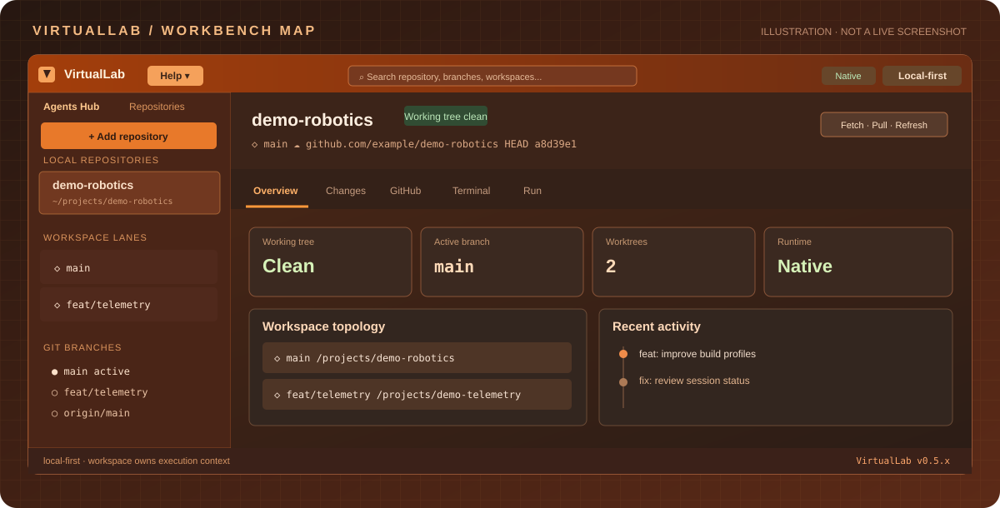
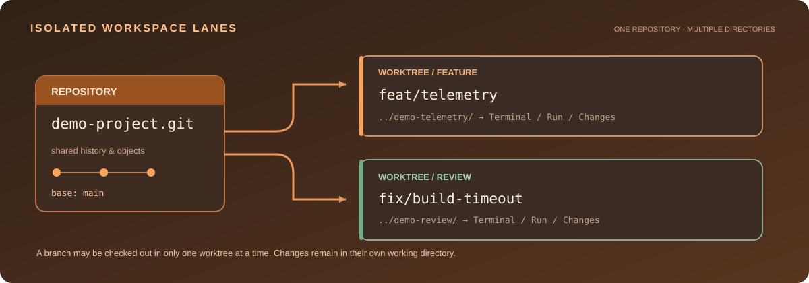
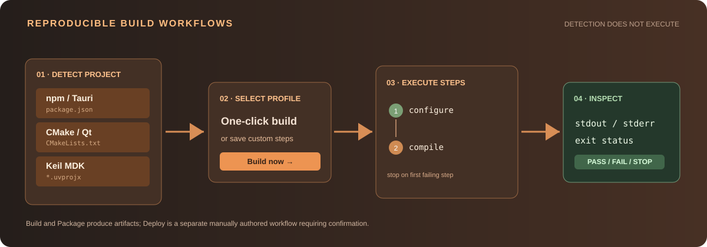
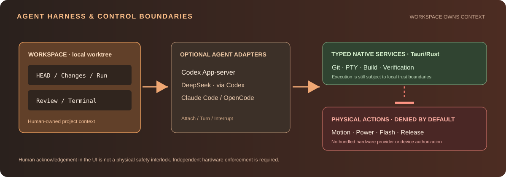

# VirtualLab 使用与集成指南

> **面向**：开发工程师、项目维护者、第三方集成商、团队评审人员。  
> **适用版本**：主线 0.5.x（以实际软件和源码为准）。  
> **程序内阅读**：GUI 顶部菜单栏 **Help → 使用文档** → 选择章节；打开独立阅读界面，不占用工作区标签，也可在未导入仓库时离线阅读。

VirtualLab 是本地优先的工程工作台：以 Git worktree 为工作单元，集成代码差异、终端、可重复构建、GitHub PR/Issue 上下文和可选 Coding Agent。**应用不绑定其他工程仓库，不包含任何硬件操作提供方或物理安全授权。**

## 01 · 工作台地图

*图 1：操作区与导航位置示意；并非某个真实仓库的运行截图。*

| 区域 | 可以做什么 | 注意 |
| --- | --- | --- |
| 应用顶部菜单栏 | **Help → 使用文档**、Native / Web preview 状态、搜索 | 文档为应用级界面，不要求先导入仓库；关闭后返回原工作区 |
| Local repositories | **Add repository** 导入现有本地 Git 项目 | 需要桌面运行时 |
| Workspace lanes | 创建、导航 Git worktree | 工作目录互相独立 |
| Git branches | 切换与删除 local/origin 分支 | 不可绕过分支保护 |
| 工作区头部 | HEAD、remote、dirty；Open in IDE、Fetch / Pull；Git 状态自动刷新 | 可直接用外部编辑器打开当前 Worktree；Pull 仅快进 |
| 功能标签 | Overview、Changes、GitHub、Terminal、Run | 按当前 worktree 执行；文档不在标签栏中 |
| 底部状态栏 | 本地执行边界、程序版本 | 不代替正式验收记录 |

### Repository、Workspace 与 Worktree

*图 2：同一个仓库共享提交对象，不同 Worktree 拥有独立的文件和执行目录。*

- **Repository**：已有本地 Git 仓库。
- **Worktree**：与 Git 分支关联的本地工作目录。同一个本地分支不能同时在两个 Worktree 检出。
- **Workspace**：VirtualLab 工作上下文，绑定 Worktree 的路径、Terminal、Run、Review、Agent thread 等。
- **PR/Issue**：可选外部上下文，不会自动接管 Git 工作目录。

## 02 · 安装与第一次使用

**准备工具**：Node.js 22.12+、npm、Git、Rust stable、Cargo。Windows 要有 Visual Studio C++ Build Tools / SDK / WebView2；macOS 需要 Xcode Command Line Tools；Linux 要安装 WebKitGTK 4.1 等原生开发包。详见 [本地构建指南](LOCAL_BUILD.md)。

~~~bash
git clone https://github.com/magic-alt/virtuallab.git
cd virtuallab
npm ci
npm run doctor
npm run tauri:dev
~~~

| 入口 | 能力 |
| --- | --- |
| **npm run tauri:dev** | 真正的桌面版，支持本地 Git、PTY、运行构建命令 |
| **npm run dev** | Vite Web preview，使用模拟数据，不支持真实原生操作 |
| **npm run tauri:build** | 输出可安装的独立桌面包 |

**首次使用四个步骤**：

1. 点击左侧 **Add repository** 选择已经初始化的 Git 仓库。
2. 在顶部确认分支、HEAD、remote 和工作树是否洁净，查看 **Overview**。
3. 进入 **Run** 选取自动发现的构建建议，或添加手动 Build profile。
4. 运行后检查 stdout/stderr 和退出状态，进入 **Changes** 检查本地代码差异。

> **提醒**：本机执行的构建脚本和 Agent 可能拥有本地系统权限。不要把导入仓库理解为项目安全认证；首次运行前需要审查构建脚本与依赖。

工作区采用**静默增量刷新**：Terminal / Coding Agent 持续修改源码时，只更新工作区的文件修改状态和 Changes 数量，不会让左侧 Git branches 列表反复进入 Loading 或使操作按钮闪烁。执行 `git add` 后会更新暂存状态；通过 Terminal 执行提交、创建分支、切换分支等 Git 元数据操作时，才会更新完整分支与 Worktree 列表。持续写入会自动合并刷新请求。工作区头部不再提供手动 Refresh 按钮；文件修改、Git 元数据变更和应用内 Git 操作都会自动刷新对应状态。

### Agents Hub：任务与已有工作区会话

应用主导航为 **Agents Hub / 工程仓库 / 设置**。全局 **Agents Hub** 统一管理 Agent：默认 **Agent 任务** 用于创建独立 Worktree、排队执行、重试与任务内报告；**工作区会话** 用于已存在工作目录中的 Provider 会话、角色/技能和恢复记录；**执行配置** 管理默认 Codex 路径、Verification Profile 和明确的 Provider / Run 配置入口。报告不再作为独立页面。全局 **设置** 提供首选 IDE、通知和终端偏好。工程仓库不再有单独的 Agents 标签，Git、Terminal、Run 等操作仍在原处。

工作区会话按实际 Git Worktree 清单选择目录，也支持仓库外部的兄弟目录。若目录已经绑定 Task，Hub 引导回该任务的执行页，使用任务的取消/重试，不会通过普通会话控制接管任务。旧版保存的 Agents 标签升级为 Overview，原仓库、Worktree 和已保存线程仍保留。

### Agents Hub：创建任务、查看报告与恢复

进入 **Agents Hub**，在 **工作任务** 中输入目标，点击 **开始任务**。应用会创建独立任务 Worktree，先检查 Git 输入，再启动 Codex。任务详情的主标签为 **概览 / 执行 / 报告**。**执行** 显示日志，**报告** 内通过 **结果报告 / 变更与审查 / 交付** 查看本次执行结果、实际收到的 Agent 总结以及独立审查与验收操作。执行历史和详细检查/验收状态可以展开查看，当前失败保持明显显示。受支持的内置换行规则允许正常的 Windows CRLF 工作区；应用不会为此改写仓库或全局 Git 配置。

任务列表显示任务 ID、时间和目标摘要，帮助区分同名任务。选择任务后核对详情中的身份，再查看执行与报告；历史验证记录保留在 Hub 的折叠区域。交付就绪仍在读取或暂不可用时，任务状态和执行输出仍可查看；完成执行不等于通过验证或人工验收。搜索、筛选、打开配置或切换页面不会启动任务，也不会停止正在运行的终端和 Agent。

任务因 Git 输入检查失败而保留下来时，解决输入问题后，选中原任务，进入 **执行 → 重试（新 Attempt）**。重试复用已绑定的任务工作区，并新增执行记录；原失败记录和现有文件会保留。若输入检查报告未提交源码，应先检查并明确处理这些修改，再重试。Codex 尚未启动的执行记录没有 Agent 总结；报告会保留原生失败原因。

验证 Profile 在任务创建时冻结。创建时未配置 Profile 的旧任务仍可重试 Codex 和查看报告，但在 **Agents Hub → 执行配置** 中新增或修改 Profile 不会更新该任务。若要使用新 Profile，请创建新任务，在 **可选设置 · 修改范围、验证 Profile、本地提交** 中选择 **正式验证 Profile（可选）**，再点击 **开始任务**。新任务以所选仓库当时的 HEAD 为基线，不会自动带入旧任务工作区的未提交修改。完整行为说明见 [Task-first Agents Hub指南](TASK_FIRST_CONTROL_CENTER.md)。

## 03 · Git Worktree 与分支管理

### 创建隔离开发工作区

1. 选中仓库，确认当前 HEAD 是预期基线。
2. 点击 **Workspace lanes → New**。
3. 选择 Base ref，输入分支名称和目标目录，确认创建。
4. 新 worktree 创建后在其中使用 Terminal、Run、Changes。
5. 需要返回时点击另一条 Workspace lane。

底层 Git 的等价示例：

~~~bash
git worktree add ../demo-feature -b feat/ui-contrast main
git worktree list
git status --short
~~~

删除 Worktree 必须由用户主动操作，并且**不能删除主 Worktree**。点击侧边栏的移除按钮后，VirtualLab 先弹出原生确认框：

1. **干净的 Worktree**：确认后使用 `git worktree remove -- <path>`，不使用强制参数；原有的本地分支不会被删除。
2. **有修改的 Worktree**（已暂存、未暂存或未跟踪文件）：先展示 Git 状态（修改和未跟踪数量）及目标路径，弹出第二个原生风险确认框。仅点击 **Force remove** 后才执行 `git worktree remove --force -- <path>`；取消不会强制删除，也不会切走当前工作区。
3. **状态发生变化**（例如弹窗期间又新增文件、修改 HEAD 或切换分支）：Rust 会拒绝使用旧快照执行强制删除，必须重新检查并确认。
4. **受锁定 / 非注册 / 主 Worktree**：仍由 Git 与 Rust 拒绝；不会绕过锁定或清理其他仓库的目录。

**数据丢失警告**：Force remove 会永久删除目标 Worktree 目录的未提交修改、未跟踪文件，也可能删除忽略的构建产物。即使是干净的 Worktree，忽略文件也可能随目录被删除。建议先 Commit、Stash 或手动备份。删除 Worktree **不等于**删除 local/origin 分支，且不会自动清理终端中仍在运行的任务。

### 使用 Zed、VS Code 或 Cursor 打开整个工程

1. 在目标 **Workspace lane** 或左侧已检出的 **Git branch** 点击代码编辑器图标（或先进入该 Workspace，再点击工作区顶部 **Open in IDE**）。
2. 工作区顶部 **Preferred editor** 可选择 **Auto-detect**、**Zed**、**VS Code** 或 **Cursor**。选择会保存在本地；每一个侧边栏入口都会使用该选择。
3. 如果选择 Auto-detect，VirtualLab 首先识别 `VISUAL` / `EDITOR` 指向的受支持 IDE；否则按 Zed → VS Code → Cursor 查找可用的应用。Windows 上会额外检查标准安装位置（包括 Zed 专用的 `%LOCALAPPDATA%\\Programs\\Zed\\bin\\zed.exe`），macOS 也检查常用 .app CLI 位置。
4. 编辑器会把**选中的整个 Worktree 目录**作为单独项目窗口打开（Zed `--new`、VS Code/Cursor `--new-window`）。在另一个 Worktree 中检出的同名项目仍使用自己的路径。文件管理器 **Open folder** 与 **Open in IDE** 是两个不同的操作。

**分支对应目录的边界：** Git branch 本身只是提交引用。没有被 Worktree 检出的 branch 并不存在专属工程目录，因此不会显示“直接在 IDE 打开”操作。先检出/创建 Worktree 再打开。该按钮不执行 Git checkout、Stash、Commit 或任何文件复制，也不会关闭已有编辑器或终端。外部 IDE 的修改仍由 VirtualLab 的文件监听器检测，Changes 会自动更新文件修改状态。

**常见问题：** 若提示找不到编辑器，请安装对应 IDE，或将其 CLI 加入 PATH。Windows 的“文件夹默认打开方式”往往是资源管理器，并不是代码编辑器，因此 Auto-detect 依据受支持的编辑器环境变量及可执行文件，而不是使用系统的文件夹关联来冒充 IDE。浏览器预览模式不支持原生启动。

### 切换和删除分支

| 操作 | 作用 | 保护 |
| --- | --- | --- |
| Switch | 本地分支切换，若被另一 worktree 占用则导航到该 worktree | 未跟踪文件冲突时 Git 可拒绝 |
| Delete local | 删除未占用且符合 Git 约束的本地分支 | 需确认；保护 main/master、占用分支 |
| Delete origin | 删除 origin 远端分支 | 独立确认；保护远端默认分支；不删本地分支 |
| Fetch（默认带 prune） | 同步远端跟踪引用、清理失效 tracking refs | 不合并、不重置工作区文件 |
| Pull | 快进更新当前分支 | 不执行 merge/reset |

**macOS 上点击 Delete origin 出现“git-credential-osxkeychain”密码弹窗？** 该弹窗要求的是 Mac 登录钥匙串密码，不是 GitHub 密码。原来的后台 Git push/ls-remote/fetch 可能继承钥匙串凭据助手；更新后的 macOS 桌面版在 GitHub HTTPS origin 上改用 `gh auth git-credential`，并禁用后台交互式认证弹窗。首先在 macOS **终端**完成一次 GitHub CLI 授权：

~~~bash
brew install gh
gh auth login --hostname github.com --git-protocol https
gh auth status -h github.com
git remote -v
~~~

如果 `gh` 没有安装或授权，VirtualLab 会拒绝删除并提示修复步骤，不会在后台反复弹出密码窗口。确认 GitHub 账号对 origin 仓库有删除分支权限；默认分支和受保护分支依然不能删除。**Delete origin 是服务端删除，区别于仅删除本地远端跟踪引用的 Fetch。** 该配置只影响 VirtualLab 发起的 GitHub HTTPS 后台操作，不修改全局 Git 配置，不会把令牌写入仓库或命令行参数。SSH 等其他 origin 继续使用 Git 原有认证方式。

### 本地修改：撤销、Stash 与安全 Pull

打开 **Changes** 页面，顶部 **Local change recovery** 区域提供三类操作，所有修改都仅作用于当前 Git worktree：

- **Stash all (safe)**：优先推荐。将暂存、未暂存以及非忽略的 untracked 文件（包括 KiCad `hardware/.history/` 等目录）保存到本地 Git stash，便于切换分支或 Pull。可在 Terminal 使用 `git stash list` 查看、`git stash pop` 恢复。忽略文件不会被删除；恢复暂存区状态可按需要使用 `git stash apply --index`。
- **Discard all tracked… / Discard selected tracked…**：将全部或选定**已跟踪**文件的暂存及未暂存修改恢复到当前 HEAD；新增到暂存区、但 HEAD 中不存在的文件可能被删除。**不可撤销**。默认不会清理任何 untracked 文件。
- **Delete selected untracked…**：先从 Worktree 文件列表选择一个未跟踪文件或目录，再点击此按钮；包含目录内非忽略文件的永久删除必须通过 Tauri 原生确认。不会对整个仓库执行无范围限制的 `git clean`，更不会使用 `git clean -x`。

所有操作先显示当前 worktree 路径和风险说明。用户取消或原生确认不可用时不执行；Rust 后端重新核对仓库注册 worktree、分支、HEAD、Git status 和选中项，发现页面已过时会拒绝操作；等待状态自动更新后，重新检查并确认。建议在撤销 KiCad 原理图改动前优先 Stash 或提交，避免丢失未同步的绘图内容。

**Pull 规则**：已跟踪文件存在 staged/unstaged 修改时仍禁用快进 Pull；仅有未跟踪文件（例如 `hardware/.history/`）时允许尝试快进，Git 在远端文件与未跟踪文件发生冲突时会安全拒绝并保留本地内容。分支切换同样不会强制覆盖未跟踪文件。

## 04 · Changes、Review、History

Monaco 提供 **Unified（上下）** 和 **Side by side（左右）** 两种只读差异布局。

| 模式 | 比较内容 | 场景 |
| --- | --- | --- |
| Worktree | 当前工作目录未暂存的已跟踪修改，以及未跟踪新文件的只读预览 | 日常自查 |
| Staged | Git index 中的暂存修改 | 提交前审查 |
| Base | 当前提交与选定基线的差异 | 分支/PR 审阅 |

未跟踪的文本文件可以**直接点击预览，无需先 git add**：左侧为空版本，右侧是文件现有内容，整份文件视为新增。未跟踪目录在 Git status 中按一个条目计数；点击该目录可按需展开最多 200 个非忽略文件，再选中子文件逐个预览。预览不更改 Git index；二进制文件和符号链接不会以文本方式打开，超过 512 KiB 的文件只展示有界内容。文件较多时请在外部 IDE 查看完整目录。

**标准代码 Review Loop**：

1. 进入 Changes，选择已跟踪文件、未跟踪新文件或展开未跟踪目录，再选择要看的文本文件。
2. 切换 Unified / Side by side，阅读对应源文件。
3. 选择行并保存本地评论草稿（此时不会发布到 GitHub）。
4. 在外部编辑器/终端修复后使用 **Refresh and re-review**。
5. HEAD 变化时重新检查过期（stale）草稿，确认后标记 reviewed。
6. 若需要回传 GitHub，匹配 PR HEAD 后**手动确认**发布选定草稿。

History 只展示近期 commit，Overview 展示 workspace 拓扑与 readiness。

## 05 · Run：npm、Qt/CMake、Keil 构建

*图 3：先在当前 worktree 读取项目文件，再由用户显式选择执行。*

**Run → One-click project builds** 可识别：

| 类型 | 项目依据 | 本机前提 |
| --- | --- | --- |
| npm / Tauri | package.json 脚本 | Node、npm、项目依赖 |
| CMake / Qt | CMakeLists.txt（包含 Qt） | CMake、Qt、目标编译器 |
| Keil MDK | 有界扫描的 *.uvprojx | Windows + Keil MDK |

运行方式包括 Build now / Package now，或者保存为自定义 Build/Test/Package/Deploy profile。多步骤 workflow 按顺序运行，**任何一步失败即停止**；通过结构化 program、args 和 cwd 执行，不拼接任意 Shell 字符串。自定义 profile 绑定仓库，保存在本机而不是 Git 中。

**构建日志与滚动：** 桌面宽屏中，Run 左侧的构建配置列表与右侧的 **Build / package output** 各自独立滚动；日志持续增加时，黑色面板保持工作区高度，不再把整个页面撑长。窄窗口改为上下布局：工作区可上下浏览，日志面板仍限制高度并在面板内滚动。向上滚动日志即可暂停自动跟随新增输出；点击 **Latest output** 回到末尾并恢复跟随。日志支持键盘聚焦后使用方向键、Page Up / Page Down 查看。Terminal 的滚动缓冲、Changes 的文件列表/差异编辑器、GitHub 的 PR / CI 列表和 Agents Hub 的事件时间线各自保留独立滚动区域。

**Windows 下在 VirtualLab 内编译 VirtualLab 自身：** 选择 VirtualLab 的 worktree，执行 **Tauri · Desktop build → Build desktop app**。程序会识别当前运行的应用，弹出 **Build and restart** 确认。确认后使用独立的 `src-tauri/target/self-build-stage-v2/` 目录，并执行 `npm run tauri:build -- --no-bundle`，仅编译新的独立 EXE、跳过 WiX/MSI/NSIS 安装包制作。这样既避免运行中的 EXE 被 Windows 锁定而报 `os error 5`，也避免安装包阶段 `candle.exe` 出错导致成功编译的 EXE 无法用于重启。构建成功才会关闭当前窗口，并在旧进程退出后启动新版；构建失败、取消或重启辅助程序启动失败均不关闭现有窗口。仅当旧 EXE 就在当前 worktree 的 `src-tauri/target/release/` 内时才替换该文件并保留旧版备份；通过安装器安装的程序或调试版不会被原地覆盖，新版会从轮换的 `src-tauri/target/self-build-runtimes/a` 或 `b` 目录启动，确保下一次编译仍不会锁住 Cargo 的输出 EXE；安装版本需要另外运行 NSIS/MSI 安装器升级。这一流程只针对当前应用，不会因为编译其他 Tauri 仓库而关闭 VirtualLab。首次使用前需先安装/启动包含此修复的 VirtualLab 版本。

### 案例 A · npm

~~~bash
npm ci
npm run build
~~~

若 package.json 存在 build 脚本，Run 可显示相应候选构建动作。请检查输出、退出状态和项目产物。**Build passed 不代表软件已经部署。**

### 案例 B · Qt/CMake 两步 profile

以下两个步骤可分别录入 Run profile（不是整段复制进一个 program）：

~~~text
Step 1 · Configure
  program: cmake
  args: -S . -B build -DCMAKE_BUILD_TYPE=Release

Step 2 · Compile
  program: cmake
  args: --build build --config Release
~~~

先在终端验证：

~~~bash
cmake --version
cmake -S . -B build -DCMAKE_BUILD_TYPE=Release
cmake --build build --config Release
~~~

Qt 的 CMAKE_PREFIX_PATH、生成器、工具链和 MSVC/MinGW 必须按实际主机配置。不要在不同机器间照搬安装路径。

### 案例 C · Keil MDK

Windows 上的命令组成示例：

~~~text
program: C:\Keil_v5\UV4\UV4.exe
args: -b Firmware.uvprojx -j0
~~~

实际路径、工程名称和目标编译器取决于第三方工程。此构建建议**不会自动烧录、使能关节电机或操作电源**。

### Package 不等于 Deploy

- **Package**：仅生成安装包或产物。
- **Deploy**：由用户明确编写步骤，并在每次启动前单独确认。
- **Stop**：尽力取消软件进程树，不构成物理安全急停。
- **Run 日志**：主要为会话内状态，不能直接用作持久不可篡改的测试证据。

详细约束：[Project Build Workflows](PROJECT_BUILD_WORKFLOWS.md)。

## 06 · Terminal、Checks、Verification

**Terminal** 是交互式 PTY，用于 Shell、人工调试、Ctrl+C；**Run** 用于重复运行结构化步骤。**Checks** 呈现本地定义的 readiness，不代表正式产品验收。

### Codex 任务完成桌面提醒

1. 打开目标 Worktree 的 **Terminal**，点击 **Start Codex with alerts**（或顶部 **Start Codex**）。这会创建独立终端并执行带 OSC 9 通知选项的 Codex；**不改写** `~/.codex/config.toml`、用户设置或其他终端的行为。
2. 输入长时间 Coding 任务后可切到另一 Worktree、页面甚至其他桌面应用。Codex 本轮结束、要求审批或等待输入时会发送明确的终端通知；VirtualLab 在后台弹出**系统桌面通知**，不强制切换当前页面。
3. 顶栏铃铛显示待查看数量。点击通知条目会回到原 Worktree、Terminal 和对应的终端会话。**Desktop alerts** 开关仅影响系统弹窗：关闭后仍保留应用内提醒。
4. 如果系统通知被操作系统阻止，会在通知中心提示错误；请在 Windows/macOS 的系统通知权限中允许 VirtualLab。

**技术边界**：手动在普通 Terminal 中输入 `codex`，Codex 可能采用 BEL（终端响铃）而不是 OSC 9，VirtualLab 仅提示「终端需要关注」，**不会把响铃当作任务完成**。使用 **Start Codex** 可为该次会话启用更明确的完成提醒；已经运行的 CLI 不会被强行重启。Claude/OpenCode 等工具如果主动发出 OSC 9，也能提示关注，但未提供结构化完成事件时不声称「任务完成」。Agents Hub 中的工作区会话通过 app-server / CLI 的结构化 turn 结束事件生成准确的完成/失败提醒，进程退出或长时间没有输出不等于任务成功。通知标题和正文不包含提示词、模型回复或终端日志，通知历史仅保留最近 50 条内存记录；任务与 PTY 生命周期保持相互独立。详见 [桌面通知专题](TERMINAL_NOTIFICATIONS.md)。

~~~bash
git status --short
git branch --show-current
git worktree list
git log -5 --oneline
~~~

底层受限 Verification 接口支持明确允许的 build/unit/evidence 进程门，按独立调用方式存储日志和 SHA-256 metadata：

~~~text
<workspace>/.virtuallab/evidence/<run-id>/
  profile.json
  manifest.json
  <gate-id>.stdout.log
  <gate-id>.stderr.log
  import-N-<filename>  # optional
~~~

**注意**：普通 Run 并不会自动生成该目录；当前底层能力也没有提供签名不可篡改的产物注册表。HIL、soak、硬件门仍为 BLOCKED。详见 [Verification and Hardware Policy](V0.4_VERIFICATION_HARDWARE_POLICY.md)。

## 07 · GitHub PR/Issue 与 Agents Hub

### GitHub 接入

~~~bash
gh --version
gh auth login
gh auth status
~~~

GitHub 面板复用本机 gh CLI 登录态与 origin URL。离线、未登录或非 GitHub origin 的项目仍可进行本地 Changes、Run 和 Worktree 操作。

PR/Issue 可用于创建预填的 Review Worktree，但**不会自动检出远端 PR head**。需要审阅远端代码时，仍应显式确认本地 SHA、远端 SHA 与基线。发布 GitHub 评论要求明确的人类操作和 HEAD 一致性校验。

### Agent 接入

*图 4：Agent 可选择性附加，物理设备权限不会从 UI 自动推导。*

| Harness | 通信/执行模式 | 限制 |
| --- | --- | --- |
| Codex | App-server JSON-RPC | 需本机 CLI 安装和配置 |
| DeepSeek | Codex + DeepSeek Responses API | 需自行配置服务与密钥 |
| Claude Code | CLI plan/read-only | 能力依赖本机 provider |
| OpenCode | CLI plan/read-only | 能力依赖本机 provider |

**直接会话操作**：打开 **Agents Hub → 工作区会话**，选择 **会话仓库 / 会话工作区** → 在 **Provider** 选择 Codex（或其他已配置的 CLI）→ 在 **Describe your request** 中写请求 → 点击 **Connect & send**。首次点击会自动检测 CLI、连接/恢复这个 Worktree 的 thread，并开始一个 turn；结果在 **Agent activity** 中显示。当前 turn 结束后可继续点击 **Send message**。这里继续的是已有工作区中的会话；需要独立 Worktree 和任务报告时，使用 **Agent 任务**。

**按钮说明**：`Check availability` 只调用本机版本检测，不连接模型也不验证账户登录；`Attach / resume` 只连接/恢复线程、不发送消息；`Interrupt turn` 中断当前 turn；`Stop runtime` 停止工作区中的 Agent 进程但保留线程关联；`Forget saved thread` 在确认后停止运行时并删除本地关联。Role/Skills、完整 JSON 事件、恢复日志及硬件审批演示已折叠到高级设置。一次仅允许一个 Agent harness 占用同一个 Worktree；并发工作应使用不同 Worktree。

**Codex 版本检测不一致（例如终端 0.162、Agents 0.157.1）**：桌面应用继承的 PATH 可能比 PowerShell/终端旧，或 Windows `where` 先找到旧版 `codex.cmd`。点击 Check availability 后查看 **Detected executable** 绝对路径，与 PowerShell 中的 `Get-Command codex -All` / `where.exe codex` 比较。若不同，展开 **CLI diagnostics · executable selection**，点击 **Choose Codex executable**，选择较新版本的真实 `codex.exe` 或 `codex.cmd`，重新检测。此设置只保存在本机，Codex/DeepSeek 共用，检测及 app-server 会使用同一可执行文件。替换/切换路径前请先 Stop runtime；若要恢复桌面自动搜索，点 **Use automatic PATH**。安装新 CLI 本身并不保证已经打开的 VirtualLab GUI 会获取新的 PATH，必要时重启桌面程序。

**安全与局限**：Codex/DeepSeek 采用 `workspace-write` + `approvalPolicy=never`，允许在当前 Worktree 中修改文件，但并非任意可信环境的强隔离；Claude/OpenCode 以 plan 模式启动。始终先在 Changes 查看 diff 再考虑合并。工作区事件流仅留在内存中（最多 300 条），重启后保留的是脱敏生命周期元数据，不是完整聊天记录。

> **重要安全边界**：人类 acknowledgement 仅记录软件决策，并非物理设备授权。VirtualLab 不包含硬件 backend；motion/power/flash/release 必须由独立硬件联锁、安全看门狗、资源授权与安全状态恢复机制实现。CLI provider 权限模式不等于 OS 沙箱。

## 08 · 三个完整实践

**实践 1 · 并行修复**：导入干净 main → 创建 feat/ui-contrast worktree → 返回 primary → 创建 fix/process-timeout worktree → 分别在 Run 构建和 Changes 审阅 → 按仓库规范自行 merge/rebase。

**实践 2 · 第三方 Qt 工程交付**：安装正确工具链 → 导入项目 → 定义 Configure / Compile 两步骤 → 检查 stdout/stderr 与构建产物 → 执行必要的人工功能测试 → 单独执行发布流程。

**实践 3 · GitHub PR 逐行审阅**：检查 gh 认证 → 选择 PR 创建工作区 → 明确获取并对齐目标 SHA → 在 Changes 中存草稿 → 修复并 Refresh and re-review → 人工确认发布选定评论。

## 09 · 常见问题

| 现象 | 检查方向 |
| --- | --- |
| Add repository 不可用 | 是否仅启动 npm run dev？需要 Tauri desktop |
| Run 找不到构建建议 | 当前 Worktree 的项目文件、脚本和支持范围；可新建自定义 Profile |
| npm / cmake 找不到 | PATH、Node / CMake 安装、同一登录用户的工具链环境 |
| Qt 配置失败 | CMAKE_PREFIX_PATH、生成器、编译器、目标平台 |
| Keil 不能编译 | Windows MDK、UV4.exe 安装位置、真实 uvprojx |
| 分支切换失败 | 其他 Worktree 占用、未跟踪文件碰撞、脏状态 |
| 本地 / origin 删除不可操作 | 是否受保护或仍被检出；远端删除需要独立确认 |
| origin 旧分支残留 | Fetch 更新跟踪信息 |
| GitHub 不可用 | gh auth status、origin、网络；不影响本地审阅 |
| Draft stale | HEAD 改变，应重新加载 Diff 与评论 |
| Run Passed 但无证据 | Run 不是 Verification evidence 写入器 |

发起公共问题报告前请先删除 token、绝对私人路径、第三方客户代码和设备序列号。提供操作系统、应用版本、最小复现步骤、预期与实际行为、已去敏错误日志。

## 10 · 二次开发与文档维护

| 位置 | 职责 |
| --- | --- |
| src/features/ | React UI（包括 Guide）、Run、Review、GitHub、Agents |
| src/stores/、src/types/ | Zustand 状态及类型契约 |
| src/lib/ | typed native 调用与前端业务 |
| src-tauri/src/ | Rust Git / PTY / process / build / agent / verification |
| docs/ | 操作、架构、验收与专题资料 |
| public/help/ | 与应用一起打包的 SVG 图解 |

~~~bash
npm ci
npm run typecheck
npm test
npm run build
cargo test --locked --manifest-path src-tauri/Cargo.toml
~~~

内置帮助中心数据定义：**src/features/help/guideContent.ts**。界面实现：**HelpCenter.tsx** 和 **helpCenter.css**，SVG 图均在 **public/help/**。当功能行为变化时应同步修订应用内内容、本指南、功能专题文档与相应测试。

更多阅读：[架构](ARCHITECTURE.md) · [本地构建](LOCAL_BUILD.md) · [Review/GitHub](V0.3_REVIEW_GITHUB.md) · [Agent harnesses](V0.5_AGENT_HARNESSES.md) · [验收策略](CONTROL_ACCEPTANCE.md)。

*全部插图均是标注的概念示意，不伪装为实时产品截图。*
