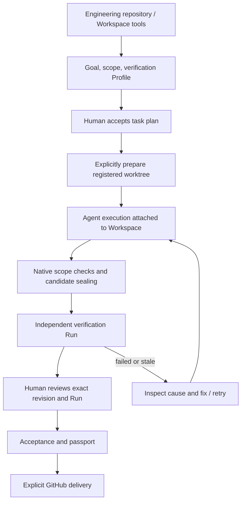

# Task-driven workbench: usable delivery workflow

Status: delivery slice A approved by the user on 2026-10-17; implementation pending.
Baseline: main `3ea67e0`, including merged PR #73.

## Intent and success criteria

Preserve the engineering repository and all existing Workspace tools. Make the
Task-first surfaces useful for real engineering work, using a user-selected
VirtualLab checkout as the first acceptance project. Repository state, terminals,
processes and attached Agents remain owned by Workspace, not by a task/session.

Success is an operator completing a small scoped change through task creation,
explicit worktree preparation, real Agent execution, native verification,
revision-bound human review and acceptance. A PR remains an explicit remote
operation through the existing GitHub tools. Local acceptance does not imply PR
creation, CI success, merge permission or release qualification.

## Observed baseline

- `TaskControlCenter.tsx` shares the task-list surface between home, tasks and
  evidence. Home adds counts; evidence adds explanatory text rather than a Run
  inventory. Settings is explicitly a read-only summary.
- `TaskPlanWizard.tsx` requires manually authored Profile JSON. Profile reuse is
  derived from existing tasks, so a fresh installation has no reusable library.
- `TaskDetail.tsx` already exposes prepare, execute, retry, cancel, verify,
  integration preview/confirmation, review, acceptance and passport export.
- Native task execution currently selects the Codex adapter. Workspace Agents
  support other harnesses, which does not establish task-coordinator parity.
- AI planning and machine review are disabled because qualified read-only
  sessions are absent. Existing session startup requests workspace-write.
- Native evidence is bound to actual source, commit, Profile, toolchain and Run;
  frontend navigation and provider messages cannot grant readiness.

## Approach choices

1. Recommended: complete the existing task workflow first, then add qualified AI
   planning/review. Reuses the tested Native execution and freshness boundaries.
2. UI-only expansion: fastest visual improvement, but leaves first-run setup and
   real execution blockers unresolved; insufficient for the requested outcome.
3. Replace orchestration with a general multi-agent framework: broad migration,
   duplicates lifecycle and evidence semantics; defer until a concrete adapter
   parity requirement justifies it.

## Interaction and ownership

The UI leads with the next available action and its blockers. It continues to
show execution, checks, current readiness and human acceptance separately.
Opening a page never provisions a worktree, starts a process or mutates Git.

## Delivery slice A: complete usable task surfaces

This is the first implementation scope. It adds no new AI planning protocol.

### Control center and task detail

- Show actionable queues: needs input, failed verification, stale evidence,
  ready for review, running/queued and recently accepted.
- Each item opens its task at the relevant detail tab. Counts and queues share
  one selector model and distinguish unavailable observations from zero.
- Derive a next-action panel from native task/readiness state. Present a clear
  explanation when an operation is unavailable. It invokes the existing typed
  operation; it does not implement a second scheduler in React.
- Preserve task filters and selection when visiting Workspace tools and back.
  Preserve the mounted workspace/terminal host and repository management.

### Verification Profile settings and task creation

- Add a versioned app-data Profile library with narrow Native list/save commands
  and typed frontend wrappers. No frontend filesystem access.
- Profiles have stable IDs and revisions. Save validates the same executor,
  relative-path and secret exclusion rules used by task acceptance. Import a
  bounded JSON document through validation; export configuration only.
- Provide an editor for name, gates, executable, argument vector, working root,
  required flag, timeout, sourcePaths, outputPaths and toolchainPrograms.
  JSON remains an advanced editor. No shell command field is introduced.
- Editing a library Profile changes future plans only. An accepted task retains
  its frozen Profile. Updating existing task policy is outside this slice.
- The creation wizard selects a saved Profile, shows the frozen snapshot and
  exposes unsupported/missing setup before acceptance.
- Provider setup links to existing Workspace configuration. Display detected
  executable/version separately from authentication and planning qualification;
  do not fabricate an authenticated status from a successful version probe.

### Evidence page

- Build an actual immutable Run inventory from task Attempts: repository, task,
  Attempt, Run, tested SHA, check outcome and observation time.
- Filter by repository/task/check outcome. Selecting a Run shows checks,
  artifact metadata, bound digests and its task link.
- Historical PASS is independent of current readiness. Only the current native
  readiness observation establishes applicability, and unavailable/stale states
  are explicit. Do not infer freshness solely from matching HEAD.
- Initial inventory uses evidence already persisted on task Attempts. It is not
  a complete retention/recovery index and must not claim otherwise. Opening raw
  archived artifacts or broader manifest discovery requires separately bounded
  Native commands and is deferred.

### Module boundaries

Split the current shared component into focused dashboard, task list, evidence
inventory and settings features. Reuse TaskDetail and Workspace tools. Keep
selectors pure and source reads in the existing store/typed clients. Add a
focused Native Profile store, sharing validation instead of copying safety rules.
Update `docs/ARCHITECTURE.md` and the Task-first operator guide for the new domain.

## Delivery slice B: qualified AI planning and review

After slice A, introduce provider-neutral capability contracts for planning and
read-only review. The first provider adapter must establish a real read-only
execution mode; a prompt that says “do not edit” is insufficient. Observe
capabilities for the selected executable/version and revoke them when selection
changes. Do not claim OS isolation from a worktree or model instruction.

Planning returns an untrusted structured proposal. Validate schema, same-repository
dependencies, paths and resource limits; show an editable proposal before human
acceptance. No proposal creates worktrees or starts implementation implicitly.
Reviewer output is advisory findings bound to fixed inputs, never human approval
or delivery PASS. Unsupported providers keep manual planning/review available.

## Delivery slice C: integration and delivery ergonomics

Show task dependencies and explicit preparation for independent implementation
worktrees plus a separate integration worktree. Reuse fixed-commit preview and
Native confirmation. Surface conflicts and recovery without replaying mutation.
Guide accepted output into existing GitHub publishing tools with an explicit
remote action, then observe PR/CI state separately from local evidence. Do not
implicitly fetch, checkout, merge or create review-loop worktrees.

## VirtualLab acceptance scenario

1. User selects a clean VirtualLab checkout and reads its current HEAD. Never
   embed its absolute path or application name into core behavior.
2. Configure a Profile appropriate to the selected host. Provision dependencies
   separately with locked installation; do not hide network installation inside
   task startup or treat dependency setup as verification.
3. Suggested checks are structured `npm run typecheck`, `npm test`,
   `npm run build`, and `cargo check --locked --manifest-path
   src-tauri/Cargo.toml`. Declare `dist` and `src-tauri/target` as generated outputs
   where applicable; observe actual selected tools and fail closed on unsupported
   launcher/source provenance. A Profile cannot exempt tracked source files.
4. Start with one small UI improvement in an explicit file scope. Prepare a
   separate task worktree, inspect Provider setup, then explicitly start Agent.
5. Check real diff, candidate and verification Run. Induce one failing check and
   one same-HEAD source change to demonstrate failure and evidence invalidation.
6. Fix and verify again. Confirm the new Run requires fresh human review and
   acceptance; export passport. Publish through explicit GitHub action if wanted.
7. Repeat later with two independent tasks and a dedicated integration task.

The chosen host scenario does not replace Linux/Windows/macOS CI, packaged-GUI
acceptance or actual authenticated-provider qualification. Any unsupported
environment must report a concrete blocker instead of weakening qualification.

## Validation and exclusions

Test meaningful behavior: first-run Profile creation/persistence, malformed
configuration rollback, accepted Profile immutability, next-action/blocker rules,
historical versus current evidence, delayed repository-switch responses,
navigation preserving terminals, and explicit-only worktree creation/execution.
Run locked npm installation, frontend typecheck/tests/build, locked Rust tests
and Linux check, plus three-host acceptance CI before completion.

No new arbitrary shell API, hardware adapter, deployment, release automation,
cross-repository DAG, transcript persistence or implicit destructive operation.
The initial implementation does not expand to multi-provider scheduling or
unrestricted artifact browsing.
